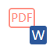
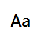
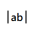
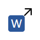

# rgPDF

[繁體中文](README.md) · English

rgPDF is a cross-platform desktop application for searching text-layer PDFs and Word documents with plain text or regular expressions. Matches appear as they are found and can be opened in an asynchronous page preview with precise, configurable highlighting.

The **rg** in its name pays homage to the text-search tool **ripgrep**.

## Features

- Multiple folder tabs with independent search conditions, results, and preview state; concurrent searches and Word PDF exports.

- Search PDFs, Word documents (`.doc` and `.docx`), or both in a folder, optionally including subfolders.
- Plain-text and regular-expression modes with optional case sensitivity and whole-word matching.
- Password-protected PDFs with retry, per-file skip, and authenticated page preview.
- Matches across lines and page boundaries, including line-end dehyphenation.
- Incremental per-match results without blocking the interface.
- Three coordinated views for files, matching passages, and PDF page preview.
- Per-character highlight geometry and configurable highlight colors.
- English and Traditional Chinese interfaces, plus system/light/dark themes.
- Persistent search and appearance preferences.

Click the preview page or its surrounding blank area to focus it, then use Left/Right or Page Up/Page Down to browse pages. The search target, file, match, and preview panes emphasize their border when they contain keyboard focus. Clicking the same match again returns to its first page after browsing elsewhere; clicking it on that page avoids reloading. A subtle thin divider sits below the tab row.

rgPDF searches existing PDF text layers and can display preliminary DOCX text matches immediately. Official Word verification and page previews require Microsoft Word (Windows), LibreOffice, or a valid cached PDF. rgPDF never runs document macros, performs OCR, or modifies source files.

Word search displays preliminary DOCX text matches marked unconfirmed, without page numbers, then replaces them with PDF-confirmed passages, counts, pages, and highlights. All tabs share one FIFO Word-to-PDF queue, merging requests for the same source and bypassing the queue for valid caches. Waiting for conversion never stops searching other files or tabs. Selecting a pending result shows an animated waiting/converting/verifying preview, updated automatically when ready. Preliminary false positives are removed. Legacy `.doc`, unsupported content, or unreadable text may require PDF verification before results are available. Opening folders does not start searches or conversion. Cancelling one tab releases only its requests and preserves conversions needed by other tabs.

**Whole word**, between Case sensitive and Regex, is off by default. When enabled, matches cannot touch Unicode word characters such as letters, digits, or underscores: `cat` matches `cat` and `cat-cat`, but excludes `catalog`, `bobcat`, and `cat_1`. It applies to literal text and regex and can be combined with case sensitivity. Preliminary DOCX and authoritative PDF results use the same setting. Contiguous Chinese characters count as word characters; no dictionary-based segmentation is performed. The option is saved independently per tab and cannot be changed during that tab's search.

PDF line breaks, page breaks and line-ending hyphens are preserved by default. Regex `^`/`$` match each line's start/end without adding `(?m)`; for example, `^\d+-\d+` finds chapter/page numbers at line starts. Use `\A`/`\Z` for the whole document or `(?-m)` to disable multiline anchors. Match across lines/pages with `alpha\s+beta`, or use `\n` for a specific break. Dot does not cross lines unless `(?s)` is enabled. Literal spaces do not automatically match line breaks.

The **Ignore layout line wraps** button beside Regex is off by default. When enabled, text blocks, adjacent-line geometry, and detected table cells guide joining: `循環` followed by `緩衝區` on the next line matches `循環緩衝區`; `buffer` / `size` retains a word space, and `inter-` / `national` removes the wrap hyphen. Actual spaces within lines are preserved. Paragraphs, columns, and different cells are not deliberately joined; page breaks remain newlines. Regex runs on this normalized text, so joined lines count as one line, while preview highlights retain each original character location. The setting is saved.

## Usage

Use Browse in Search target, Open folder at the start of the main toolbar, or file/folder drops to open folder tabs. Dropped files use their parent folders; all valid items are processed. Already-open folders are activated rather than duplicated. New tabs can be opened during searches or exports. Enter text or a regular expression and press Search, then select matching files/passages to preview them. The status bar shows the current tab and the number of other background jobs; Cancel affects only the current tab.

Each tab retains its own pattern, stem filter, file types, search options, results, preview page, zoom, and scrolling. New tabs inherit current search conditions but start with empty results and default their export destination to the new folder. Tabs can be reordered and closed; duplicate folder names include parent paths, and tooltips show full paths. Closing a busy tab asks to cancel its work, then cleans up only that tab. One search or export runs per tab, while different tabs can run concurrently. Restarting restores tab order, active tab, conditions, and export destinations without restoring results or automatically searching. Language, theme, and highlight color are application-wide.

One thin rounded frame encloses both the tab strip and content, immediately below the toolbar without a separate toolbar bottom rule or extra top gap. The toolbar matches the window background, and the tab row is a compact 32 px high. Flat inactive tabs blend into the background; the selected tab has a contrasting surface and a bottom accent line (blue in light mode, neon green in dark mode). Inactive tabs continue the thin divider between tabs and content. Close buttons use a thin × with a background only on hover. The toolbar shares the frame’s 12 px side margins, aligning both left and right edges.

Clearing the shared Word cache removes Word results from all tabs while preserving native PDF results. Clearing is disabled while any tab or shared conversion remains active.

When a PDF requires an opening password, rgPDF prompts with masked input. Incorrect passwords can be retried; **Skip file** continues with other documents and records a warning. Successful credentials are reused for that file during the current application session, including search, preview, navigation, and zoom. They are cleared on exit and invalidated when the source changes. Passwords are never written to settings, search results, or caches, and no decrypted PDF copy is created.

The **Filename stem filter** below **Document folder** optionally limits which files are searched. Click the help icon immediately to the left of its input field to view syntax explanations and examples. Leave it empty for no filter. It matches the entire filename without its last extension, ignoring case, and supports `*` (any string), `?` (one character), `[abc]`, `[0-9]`, and `[!abc]`. For example, `ch0*` includes `ch01.pdf` and `ch02.docx` but excludes `ch1.pdf` and `ch2.docx`; `ch01` matches that exact stem. The filter applies before PDF reading or Word conversion and works together with file-type and subfolder settings. It is saved between sessions and is independent of the text search’s regex and case settings.

Use **Export Word files as PDF** on the toolbar to select `.doc`/`.docx` files and an output folder. The list follows the filename-stem filter and subfolder setting, independently of the search file type or content pattern. The button is disabled without eligible Word files and uses opaque pastel artwork so overlapping marks do not show through; Word temporary lock files are excluded. Files retain their original stem plus `.pdf` and are placed directly in the output folder without subfolders. Valid cached PDFs are copied directly; otherwise Microsoft Word/LibreOffice creates a shared cache entry before export. Sources are unchanged. Existing PDFs are skipped unless overwrite is enabled. Deselect duplicate stems before exporting. The status bar shows progress; cancellation retains completed exports and caches. Individual failures do not stop the remaining files.

Use the preview’s Previous page / Next page buttons to browse all document pages, including pages without a match. Select another passage in the match pane to jump to its matched page. **Fit page** scales the whole page to the preview’s width and height and adapts when the pane is resized; **Fit width** remains available for reading at a larger size.

<picture><source media="(prefers-color-scheme: dark)" srcset="docs/toolbar/dark/trim_box.png"></picture> **Crop preview to TrimBox**, at the right of the preview zoom tools, is off by default. Enable it to show each PDF page's finished TrimBox area; Fit width/page then scales that area for easier reading. Toggle it off to restore the full preview. This uses PDF metadata rather than detecting text bounds; missing or unusable boxes retain the original visible page. The toggle survives page/match changes independently per folder tab but is not saved across app restarts. Cropping affects only the preview and clipboard PNG/selectable text, leaving source files, search scope, and Word PDF exports unchanged.

The preview toolbar provides <picture><source media="(prefers-color-scheme: dark)" srcset="docs/toolbar/dark/select_text.png"></picture> **Select and copy text**, enabled by default. Drag to select text on the current page; releasing the mouse automatically copies it to the clipboard. Dragging does not repeatedly write to the clipboard. Ctrl+A/⌘A selects and copies all page text; Esc clears the visible selection. Selection supports CJK text, multiple lines, zoom, rotated pages, and authenticated PDFs. Changing pages/files or re-rendering at a new scale clears the selection. Pages without a text layer cannot be selected; existing search highlights remain visible.

Separators group the preview toolbar into page navigation, copying, and zoom controls. <picture><source media="(prefers-color-scheme: dark)" srcset="docs/toolbar/dark/copy_page.png"></picture> **Copy current page as PNG** places the complete rendered preview area on the clipboard for pasting into image-capable applications. It uses the current preview resolution and includes search highlights and content outside the scroll viewport, excluding toolbar controls and text selection overlays. No disk file is created. Pages without a text layer can also be copied; copying is disabled while loading.
The controls below list the Search target options first, followed by the main toolbar actions. Hover over a
button to see its current setting; clicking a three-state button cycles modes.

Enabled toggle buttons retain the same background as their hover state. The dark theme uses an EVA Unit-01-inspired palette: deep purple surfaces, neon-green selections and enabled controls, with restrained orange focus and link accents. Document previews retain their original page colors.

The toolbar places File manager integration, Language, and Theme on the right; Open folder, highlight color, cache clearing and Word export are on the left, in that order. Include subfolders, file type, case sensitivity, Whole word, Regex and Ignore line wraps belong to each tab’s Search target pane and are absent from the main toolbar. On Windows, About rgPDF is in the system menu opened by clicking the application icon at the top-left of the main window or pressing Alt+Space. macOS uses the native application menu; other platforms use the rgPDF menu. About provides version, license, and source links.

| Icon | Control | Usage |
| --- | --- | --- |
| <picture><source media="(prefers-color-scheme: dark)" srcset="docs/toolbar/dark/recursive.png"></picture> | Include subfolders | Toggle recursive folder search. |
| <picture><source media="(prefers-color-scheme: dark)" srcset="docs/toolbar/dark/scope_pdf.png"></picture> <picture><source media="(prefers-color-scheme: dark)" srcset="docs/toolbar/dark/scope_word.png"></picture> <picture><source media="(prefers-color-scheme: dark)" srcset="docs/toolbar/dark/scope_all.png"></picture> | File types | Cycle PDF → Word (DOC/DOCX) → both. Word requires Microsoft Word on Windows or LibreOffice. |
| <picture><source media="(prefers-color-scheme: dark)" srcset="docs/toolbar/dark/case.png"></picture> | Case sensitive | Toggle case-sensitive matching. |
| <picture><source media="(prefers-color-scheme: dark)" srcset="docs/toolbar/dark/whole_word.png"></picture> | Whole word | Match complete words in literal and regex modes; off by default. |
| <picture><source media="(prefers-color-scheme: dark)" srcset="docs/toolbar/dark/regex.png"></picture> | Regular expression | Toggle regex; use the help icon beside the search field for examples. |
| <picture><source media="(prefers-color-scheme: dark)" srcset="docs/toolbar/dark/line_wrap.png"></picture> | Ignore layout line wraps | Join adjacent CJK lines, preserve English word spaces and original highlights; off by default. |
| <picture><source media="(prefers-color-scheme: dark)" srcset="docs/toolbar/dark/add_folder.png"></picture> | Open folder tab |
| <picture><source media="(prefers-color-scheme: dark)" srcset="docs/toolbar/dark/highlighter.png"></picture> | Highlight color | The swatch shows the current color; click to choose a preset or custom color. |
| <picture><source media="(prefers-color-scheme: dark)" srcset="docs/toolbar/dark/cache.png"></picture> | Clear Word cache | Clear shared conversion PDFs and Word results across tabs; preserve sources. Disabled while any job or conversion is active. |
| <picture><source media="(prefers-color-scheme: dark)" srcset="docs/toolbar/dark/export_pdf.png"></picture> <picture><source media="(prefers-color-scheme: dark)" srcset="docs/toolbar/dark/export_pdf_disabled.png"></picture> | Export Word files as PDF | Overlapping Word (upper-left) and PDF (lower-right) logos, connected by an arrow going down from Word and turning right into PDF; select files and an output folder to export cached or newly converted PDFs. |
| <picture><source media="(prefers-color-scheme: dark)" srcset="docs/toolbar/dark/context_menu.png"></picture> | File manager integration | Toggle Explorer context menus / Finder Quick Action; checked when registered. |
| <picture><source media="(prefers-color-scheme: dark)" srcset="docs/toolbar/dark/language_system.png"></picture> <picture><source media="(prefers-color-scheme: dark)" srcset="docs/toolbar/dark/language_zh.png"></picture> <picture><source media="(prefers-color-scheme: dark)" srcset="docs/toolbar/dark/language_en.png"></picture> | Language | Cycle system → Traditional Chinese → English. |
| <picture><source media="(prefers-color-scheme: dark)" srcset="docs/toolbar/dark/theme_system.png"></picture> <picture><source media="(prefers-color-scheme: dark)" srcset="docs/toolbar/dark/sun.png"></picture> <picture><source media="(prefers-color-scheme: dark)" srcset="docs/toolbar/dark/moon.png"></picture> | Color theme | Cycle system → light → dark. |

Hover over an icon to see its action. Search, color, and preview controls:

| Icon | Tooltip / action |
| --- | --- |
| <picture><source media="(prefers-color-scheme: dark)" srcset="docs/toolbar/dark/browse.png"></picture> | Browse… |
| <picture><source media="(prefers-color-scheme: dark)" srcset="docs/toolbar/dark/search.png"></picture> | Search |
| <picture><source media="(prefers-color-scheme: dark)" srcset="docs/toolbar/dark/cancel.png"></picture> | Cancel |
| <picture><source media="(prefers-color-scheme: dark)" srcset="docs/toolbar/dark/help.png"></picture> | Search pattern help |
| <picture><source media="(prefers-color-scheme: dark)" srcset="docs/toolbar/dark/custom_color.png"></picture> | Custom color… |
| <picture><source media="(prefers-color-scheme: dark)" srcset="docs/toolbar/dark/previous_page.png"></picture> | Previous page |
| <picture><source media="(prefers-color-scheme: dark)" srcset="docs/toolbar/dark/next_page.png"></picture> | Next page |
| <picture><source media="(prefers-color-scheme: dark)" srcset="docs/toolbar/dark/zoom_out.png"></picture> | Zoom out |
| <picture><source media="(prefers-color-scheme: dark)" srcset="docs/toolbar/dark/zoom_in.png"></picture> | Zoom in |
| <picture><source media="(prefers-color-scheme: dark)" srcset="docs/toolbar/dark/fit_width.png"></picture> | Fit width |
| <picture><source media="(prefers-color-scheme: dark)" srcset="docs/toolbar/dark/fit_page.png"></picture> | Fit page |
| <picture><source media="(prefers-color-scheme: dark)" srcset="docs/toolbar/dark/trim_box.png"></picture> | Crop preview to TrimBox |

Search settings are saved between sessions. Conversion cache is cleaned at
startup: entries unused for 30 days expire, then the oldest entries are removed
if total size exceeds 500 MB. Use **Cancel** to stop a search.

The file list sits above the match list on the left, each using the full left-pane width. Drag their divider to adjust heights; the page preview remains on the right.

## Explorer and Finder context menus

The **File manager integration** toggle immediately left of Language installs or removes the integration. Its checked background reflects actual registration and stays synchronized across folder tabs; the tooltip describes the available action. Windows and macOS share this control; it is disabled on other platforms.

Windows: click the toggle to add the Explorer context menu. Right-click a PDF/Word file (`.pdf`, `.doc`, `.docx`), a folder or a folder's blank background and choose **Open in rgPDF**. On Windows 11, it may appear under **Show more options**. Click the toggle again to remove it. The background action requires no selection; multiple selected folders are delivered individually to tabs in the same window.

macOS: place the app in a permanent location first (preferably Applications), then click the toggle to add a Finder Quick Action. Right-click selected folders or PDF/Word files and choose **Open in rgPDF** under **Quick Actions/Services**. Multiple selected folders or supported files are accepted; Finder's blank background has no equivalent action. If absent, enable the service in System Settings keyboard shortcuts / Services, or log in again. Click the toggle again to remove it.

Both integrations are opt-in, per-user, require no administrator privileges, and are never installed automatically. If rgPDF is running, the action forwards paths to its existing window and opens or selects folder tabs; otherwise it starts the app and restores the session. Neither starts a search. Paths can also be queued while the app is starting, avoiding duplicate GUI and PDF-engine loading. Register again after moving the app; on macOS, remove and reinstall the action. Commands are also available:

```shell
rgpdf --install-context-menu
rgpdf --remove-context-menu
rgpdf "folder path" "another folder path"
```

Opening a file from the context menu or command line uses its parent folder as the search target without starting a search. Existing default PDF/Word applications remain unchanged. Launching without arguments brings back the existing window; use `rgpdf --new-window` for an independent window. In a development checkout, use `uv run rgpdf ...`; the Windows portable executable accepts the same arguments.

## Install the latest release

### Windows standalone download

Download the versioned `rgpdf-*-windows-x86_64.zip` and its `.sha256` file
from the [latest GitHub Release](https://github.com/codemee/rgpdf/releases/latest).
Verify the ZIP's SHA-256, extract it completely, and run `rgpdf/rgpdf.exe`. Keep the adjacent `_internal` folder and move the entire `rgpdf` directory together. The app uses these files directly, without startup extraction or a separate runtime cache; existing settings and Word conversion cache locations are unchanged. The executable is currently unsigned, so Windows SmartScreen may show an unknown-publisher warning.

No Python or uv installation is required for the standalone executable. PDF search has no additional requirement. Word search requires an existing Microsoft Word installation on Windows or an existing LibreOffice installation.

### macOS App (Apple Silicon)

Download the versioned `rgpdf-*-macos-arm64.dmg` and its `.sha256` file from
the [latest GitHub Release](https://github.com/codemee/rgpdf/releases/latest).
Verify the download first:

```shell
shasum -a 256 rgpdf-*-macos-arm64.dmg
```

After confirming that the output matches the `.sha256` file, open the DMG and
drag `rgpdf.app` to Applications. This build supports Apple Silicon (M-series)
Macs and does not require Python or uv.

The App is ad-hoc signed and not notarized by Apple. If macOS blocks its first
launch, Control-click `rgpdf` in Finder's Applications folder, choose Open,
then choose Open again in the confirmation dialog.

### Install with uv

Install [uv](https://docs.astral.sh/uv/), then install the latest release from PyPI:

```shell
uv tool install rgpdf
```

Run the application:

```shell
rgpdf
```

To update an existing installation:

```shell
uv tool upgrade rgpdf
```

Windows and macOS are supported; uv manages the required Python environment.

To install the latest source release directly from GitHub instead, use the moving `latest` tag:

```shell
uv tool install "git+https://github.com/codemee/rgpdf.git@latest"
```

## Development

```shell
git clone https://github.com/codemee/rgpdf.git
cd rgpdf
uv sync
uv run python scripts/check.py
uv run rgpdf
```

During development, target relevant tests with `uv run python scripts/check.py tests/test_ui.py`; run without paths when the implementation settles. A full pass is reused only for identical code, tests, dependencies and environment. Version/documentation-only changes still check version consistency; `--force` reruns tests.

After toolbar artwork changes, regenerate the README images with
`uv run python scripts/generate_toolbar_icons.py`.

See [Technical details](docs/TECHNICAL.md) for architecture, matching semantics, concurrency, and release engineering. Version history is in the [changelog](CHANGELOG.md).

## Releases

[GitHub Releases](https://github.com/codemee/rgpdf/releases/latest) provide Windows folder ZIPs, macOS Apps, SHA-256 checksums, and corresponding source archives. Python packages are available on PyPI. The `latest` Git tag points to the newest published source release.

See [Technical details](docs/TECHNICAL.md#release-process) for the release workflow and maintenance instructions.

## License

rgPDF is licensed under the [GNU Affero General Public License version 3](LICENSE).
You may use, study, modify, and redistribute it under the terms of that license.
Distributed binaries must be accompanied by the complete corresponding source
for the same version.

This application uses PyMuPDF/MuPDF under AGPLv3 and PySide6/Qt under LGPLv3.
See [third-party notices](THIRD-PARTY-NOTICES.md) and the
[release compliance checklist](docs/RELEASING.zh-TW.md).
