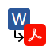

# rgPDF

繁體中文 · [English](README.en.md)

rgPDF 是一套跨平台桌面工具，可使用純文字或規則表達式搜尋具有文字層的 PDF 與 Word 文件。每筆命中會在找到時立即顯示，並可在非同步頁面預覽中查看精確且可自訂顏色的螢光筆標示。

名稱中的 **rg** 是向文字搜尋工具 **ripgrep** 致敬。

## 功能

- 多資料夾標籤，各自保留搜尋條件、結果與預覽；可同時搜尋或匯出 Word PDF。

- 可選擇搜尋 PDF、Word 文件（`.doc`、`.docx`）或兩者，並可選擇是否包含子資料夾。
- 支援純文字、規則表達式及區分大小寫。
- 支援需要密碼的 PDF：可重試、略過單一文件，並沿用已驗證密碼預覽。
- 支援跨行、跨頁匹配與行尾英文斷字合併。
- 每找到一筆結果就立即顯示，搜尋期間介面仍可操作。
- 檔案、命中段落與 PDF 頁面預覽三個連動區域。
- 逐字元反白座標與可自訂的螢光筆顏色。
- 繁體中文／英文介面，以及系統／淺色／深色主題。
- 保存搜尋與外觀偏好。

rgPDF 搜尋 PDF 已有的文字層，也能先顯示 DOCX 的初步文字命中。Word 的正式確認與頁面預覽需要 Microsoft Word（Windows）、LibreOffice 或有效的 PDF 快取。rgPDF 不會執行文件巨集、不執行 OCR，也不修改來源檔案。

Word 搜尋會先直接讀取 DOCX 文字，立即顯示標為「待確認」的初步命中，再以 PDF 校正正式段落、筆數、頁碼及螢光標示；初步結果不提供頁碼。所有標籤的 Word 轉 PDF 共用一個依序處理的佇列，相同來源會合併轉檔，已有有效快取則直接使用。等待轉檔不會暫停其他檔案或標籤的搜尋。選到尚未就緒的結果時，預覽顯示等待／轉檔／確認動畫，PDF 完成後自動更新；確認沒有命中就移除初步結果。舊式 `.doc`、特殊內容或無法抽取的文件必要時等 PDF 確認。開啟資料夾不會自動搜尋或轉檔；取消某個標籤只取消該標籤的需求，不影響其他標籤共用的轉檔。

工具列 Regex 按鈕旁的「忽略排版換行」預設關閉。啟用後，會依文字區塊、相鄰行位置及偵測到的表格儲存格接合排版換行：例如 `循環` 換行 `緩衝區` 可搜尋 `循環緩衝區`，英文 `buffer` 換行 `size` 保留詞間空格，`inter-` 換行 `national` 合併斷字。行內實際空格保留，段落／欄位／不同儲存格不主動接合，跨頁維持空格。Regex 套用在此正規化後的文字上；預覽仍標示原本每行的字元位置。此設定會保存。

## 使用方式

搜尋遇到需要密碼的 PDF 時會提示輸入，密碼以遮罩顯示；輸入錯誤可重試，按「略過此檔」則繼續搜尋其他文件，並於完成後列入警告。同一份文件在本次程式工作階段內可沿用已驗證密碼搜尋、預覽、換頁與縮放；關閉程式即清除，來源檔案變更後會重新驗證。密碼不寫入設定、搜尋結果或快取，也不產生解密後的 PDF 副本。

在左上「搜尋標的」窗格按「瀏覽」、按標籤列的新增資料夾按鈕，或將檔案／資料夾拖放到視窗，即可開啟資料夾標籤。檔案使用所在資料夾，多項拖放逐一處理；已開啟的資料夾直接切換，不重複建立，搜尋或匯出期間也可繼續開啟標籤。輸入文字或規則表達式後按「搜尋」，選取檔案及命中段落即可查看預覽。狀態列顯示目前標籤的進度與其他背景工作數量，取消按鈕只作用於目前標籤。

各標籤獨立保存搜尋樣式、主檔名篩選、檔案類型、搜尋選項、結果、預覽頁面、縮放與捲動位置。新標籤沿用目前搜尋條件，清空結果，匯出目的地預設為新資料夾。標籤可拖曳排序及關閉，同名資料夾會補上上層路徑，滑鼠停留可查看完整路徑；關閉工作中的標籤會詢問是否取消，確認後清理該頁工作。每個標籤一次執行一個搜尋或匯出，不同標籤可同時進行。下次啟動恢復標籤順序、目前標籤、各頁條件與匯出目的地，不恢復結果、不自動搜尋。語言、配色與螢光筆顏色全視窗共用。

標籤採平面樣式，並以細線外框連接下方整個內容區。未選取時與背景融合，選取時顯示淡色底與下緣色線（淺色為藍色、深色沿用螢光綠），底線與內容框上緣貼合，未選取標籤下方也會延續細框線。關閉按鈕使用細線 ×，滑鼠移入才顯示底色。

手動清除 Word 快取會影響所有標籤並移除其 Word 結果，保留原生 PDF 結果；任一標籤工作或共用轉檔尚未完成時不能清除。

「文件資料夾」下方的「主檔名篩選」可限制要搜尋的檔案，留空時不篩選。點擊輸入欄位左側的說明圖示，可查看語法說明與範例。此欄位比對不含最後一個副檔名的完整主檔名，不區分大小寫；支援 `*`（任意字串）、`?`（單一字元）、`[abc]`、`[0-9]` 與 `[!abc]`。例如 `ch0*` 會包含 `ch01.pdf`、`ch02.docx`，排除 `ch1.pdf`、`ch2.docx`；`ch01` 則只比對完全相同的主檔名。篩選會在讀取 PDF 或轉換 Word 前執行，並搭配檔案類型與子資料夾設定；此欄位會保存至下次啟動，不受文字搜尋的 Regex 與區分大小寫設定影響。

使用工具列的「將 Word 檔匯出為 PDF」可勾選目前資料夾中的 `.doc`／`.docx`，再指定輸出資料夾。清單沿用主檔名篩選及子資料夾設定，不受搜尋檔案類型或搜尋樣式影響；沒有符合條件的 Word 檔時按鈕停用，Word 暫存鎖定檔不列入。每份檔案以原主檔名加上 `.pdf` 匯出到指定資料夾，不保留子資料夾結構。已有有效 PDF 快取就直接複製，否則先透過 Microsoft Word／LibreOffice 轉檔寫入共用快取，再匯出；不修改來源。預設略過既有同名 PDF，可勾選覆寫；若所選 Word 檔會產生同名 PDF，須先取消重複項目的勾選。狀態列顯示匯出進度，可取消後續作業；已匯出檔案與已完成的快取會保留，個別失敗不會中止其他檔案。

預覽窗格的「上一頁／下一頁」會逐頁瀏覽整份文件，包含未命中頁；選取命中項目窗格中的其他段落即可跳至其命中頁面。「符合頁面」會依預覽區域的寬度與高度完整顯示整頁，並隨窗格大小調整；「符合寬度」則可用較大尺寸閱讀。

預覽工具列提供 <picture><source media="(prefers-color-scheme: dark)" srcset="docs/toolbar/dark/select_text.png"></picture>「選取並複製文字」工具，預設啟用。以滑鼠拖曳選取目前頁面的文字，放開滑鼠後即自動複製到剪貼簿；拖曳期間不會重複寫入。Ctrl+A／⌘A 可選取並複製整頁文字，Esc 清除畫面選取。支援中文、跨行、縮放與旋轉頁面，以及已解鎖的加密 PDF；換頁、換檔或重新縮放會清除選取。沒有文字層的頁面無法選取文字，原命中標示仍保留。

預覽工具列以分隔線區分翻頁、複製及縮放功能。<picture><source media="(prefers-color-scheme: dark)" srcset="docs/toolbar/dark/copy_page.png"></picture>「複製目前頁面為 PNG」會將完整頁面影像放入剪貼簿，可直接貼入支援圖片的應用程式。影像採目前預覽解析度，包含命中標示與捲動區外的內容，不包含工具列或文字選取底色；不建立磁碟檔案。沒有文字層的頁面亦可複製，載入期間按鈕會停用。

下表依工具列由左至右排列；滑鼠停留可查看目前設定，三態按鈕每按一次切換一個狀態。

狀態按鈕啟用後會持續顯示與滑鼠移入相同的底色。深色配色採初號機風格：深紫底色、螢光綠的選取與啟用狀態，搭配少量橘色焦點與連結；文件預覽保留原始頁面顏色。

工具列右側為「語言、配色」，其餘搜尋工具靠左排列。「關於 rgPDF」位於 Windows 主視窗左上角應用程式圖示的系統功能表（亦可按 Alt+Space 開啟）；macOS 使用原生應用程式功能表，其他平台則位於 rgPDF 功能表，可查看版本、授權與原始碼連結。

| 工具列圖示 | 功能 | 操作說明 |
| --- | --- | --- |
| <picture><source media="(prefers-color-scheme: dark)" srcset="docs/toolbar/dark/recursive.png"></picture> | 包含子資料夾 | 切換是否遞迴搜尋子資料夾。 |
| <picture><source media="(prefers-color-scheme: dark)" srcset="docs/toolbar/dark/scope_pdf.png"></picture> <picture><source media="(prefers-color-scheme: dark)" srcset="docs/toolbar/dark/scope_word.png"></picture> <picture><source media="(prefers-color-scheme: dark)" srcset="docs/toolbar/dark/scope_all.png"></picture> | 搜尋檔案類型 | 循環切換 PDF → Word（DOC／DOCX）→ 兩者。搜尋 Word 需已有 Windows Microsoft Word 或 LibreOffice。 |
| <picture><source media="(prefers-color-scheme: dark)" srcset="docs/toolbar/dark/case.png"></picture> | 區分大小寫 | 切換搜尋時是否區分大小寫。 |
| <picture><source media="(prefers-color-scheme: dark)" srcset="docs/toolbar/dark/regex.png"></picture> | 規則表達式 | 切換 Regex；搜尋欄旁的說明圖示提供語法範例。 |
| <picture><source media="(prefers-color-scheme: dark)" srcset="docs/toolbar/dark/line_wrap.png"></picture> | 忽略排版換行 | 接合相鄰行的中文文字、保留英文詞間空格與原座標標示；預設關閉。 |
| <picture><source media="(prefers-color-scheme: dark)" srcset="docs/toolbar/dark/highlighter.png"></picture> | 螢光筆顏色 | 色塊顯示目前顏色；點選後可選預設色或自訂顏色。 |
| <picture><source media="(prefers-color-scheme: dark)" srcset="docs/toolbar/dark/cache.png"></picture> | 清除 Word 快取 | 刪除共用快取與各標籤的 Word 結果，保留來源；任一工作或轉檔期間停用。 |
| <picture><source media="(prefers-color-scheme: dark)" srcset="docs/toolbar/dark/export_pdf.png"></picture> | 將 Word 檔匯出為 PDF | Word 在左上、PDF 在右下交疊，箭頭從 Word 下緣向下，再轉直角向右指向 PDF；勾選檔案與輸出資料夾，沿用快取或轉檔後匯出。 |
| <picture><source media="(prefers-color-scheme: dark)" srcset="docs/toolbar/dark/language_system.png"></picture> <picture><source media="(prefers-color-scheme: dark)" srcset="docs/toolbar/dark/language_zh.png"></picture> <picture><source media="(prefers-color-scheme: dark)" srcset="docs/toolbar/dark/language_en.png"></picture> | 語言 | 循環切換跟隨系統 → 繁體中文 → English。 |
| <picture><source media="(prefers-color-scheme: dark)" srcset="docs/toolbar/dark/theme_system.png"></picture> <picture><source media="(prefers-color-scheme: dark)" srcset="docs/toolbar/dark/sun.png"></picture> <picture><source media="(prefers-color-scheme: dark)" srcset="docs/toolbar/dark/moon.png"></picture> | 配色 | 循環切換跟隨系統 → 淺色 → 深色。 |

將滑鼠停留在圖示上即可查看功能說明。搜尋、顏色設定與預覽按鈕如下：

| 圖示 | Tooltip／功能 |
| --- | --- |
| <picture><source media="(prefers-color-scheme: dark)" srcset="docs/toolbar/dark/browse.png"></picture> | 瀏覽… |
| <picture><source media="(prefers-color-scheme: dark)" srcset="docs/toolbar/dark/add_folder.png"></picture> | 開啟資料夾標籤 |
| <picture><source media="(prefers-color-scheme: dark)" srcset="docs/toolbar/dark/search.png"></picture> | 搜尋 |
| <picture><source media="(prefers-color-scheme: dark)" srcset="docs/toolbar/dark/cancel.png"></picture> | 取消 |
| <picture><source media="(prefers-color-scheme: dark)" srcset="docs/toolbar/dark/help.png"></picture> | 搜尋樣式說明 |
| <picture><source media="(prefers-color-scheme: dark)" srcset="docs/toolbar/dark/custom_color.png"></picture> | 自訂顏色… |
| <picture><source media="(prefers-color-scheme: dark)" srcset="docs/toolbar/dark/previous_page.png"></picture> | 上一頁 |
| <picture><source media="(prefers-color-scheme: dark)" srcset="docs/toolbar/dark/next_page.png"></picture> | 下一頁 |
| <picture><source media="(prefers-color-scheme: dark)" srcset="docs/toolbar/dark/zoom_out.png"></picture> | 縮小 |
| <picture><source media="(prefers-color-scheme: dark)" srcset="docs/toolbar/dark/zoom_in.png"></picture> | 放大 |
| <picture><source media="(prefers-color-scheme: dark)" srcset="docs/toolbar/dark/fit_width.png"></picture> | 符合寬度 |
| <picture><source media="(prefers-color-scheme: dark)" srcset="docs/toolbar/dark/fit_page.png"></picture> | 符合頁面 |

搜尋設定會保存至下次啟動。啟動時會刪除 30 天未使用的轉換快取，若總量仍超過 500 MB，優先刪除最久未使用的項目。搜尋期間可按「取消」停止。

## 安裝最新版本

### Windows 免安裝版

從 [最新 GitHub Release](https://github.com/codemee/rgpdf/releases/latest)下載有版本編號的 `rgpdf-*-windows-x86_64.exe` 與對應 `.sha256` 檔。執行檔目前未簽章，因此 Windows SmartScreen 可能顯示未知發布者警告；選擇執行前，請先確認 SHA-256 與發布頁提供的值相同。

免安裝版不需要 Python 或 uv。搜尋 PDF 不需其他軟體；搜尋 Word 則需要 Windows 上既有的 Microsoft Word，或已安裝 LibreOffice。

### macOS App（Apple Silicon）

從[最新 GitHub Release](https://github.com/codemee/rgpdf/releases/latest)下載有版本編號的 `rgpdf-*-macos-arm64.dmg` 與對應 `.sha256` 檔。先核對下載檔：

```shell
shasum -a 256 rgpdf-*-macos-arm64.dmg
```

確認輸出與 `.sha256` 檔相同後，開啟 DMG，將 `rgpdf.app` 拖曳至 Applications。這個版本適用 Apple Silicon（M 系列）Mac，不需要安裝 Python 或 uv。

App 只有 ad-hoc 簽章且未經 Apple 公證。若 macOS 阻擋首次啟動，請在 Finder 的 Applications 中按住 Control 點按 `rgpdf`、選擇「打開」，再於確認視窗選擇「打開」。

### 使用 uv 安裝

先安裝 [uv](https://docs.astral.sh/uv/)，再從 PyPI 安裝最新發布版本：

```shell
uv tool install rgpdf
```

執行程式：

```shell
rgpdf
```

更新已安裝的版本：

```shell
uv tool upgrade rgpdf
```

支援 Windows 與 macOS，所需 Python 環境由 uv 管理。

若要直接從 GitHub 安裝最新原始碼發布版本，請使用會移動的 `latest` 標籤：

```shell
uv tool install "git+https://github.com/codemee/rgpdf.git@latest"
```

## 開發

```shell
git clone https://github.com/codemee/rgpdf.git
cd rgpdf
uv sync
uv run pytest
uv run rgpdf
```

工具列圖示修改後，使用 `uv run python scripts/generate_toolbar_icons.py` 更新 README 圖片。

架構、匹配語意、並行處理與發布方式請參閱[技術細節](docs/TECHNICAL.zh-TW.md)，版本歷程請參閱[變更紀錄](CHANGELOG.zh-TW.md)。

## 發布版本

[GitHub Releases](https://github.com/codemee/rgpdf/releases/latest) 提供 Windows 執行檔、macOS App、SHA-256 檢查碼與對應原始碼；Python 套件可從 PyPI 安裝。`latest` Git 標籤指向最新發布版本的原始碼。

發布流程與維護說明請參閱[技術細節](docs/TECHNICAL.zh-TW.md#發布流程)。

## 授權

rgPDF 依 [GNU Affero General Public License version 3](LICENSE) 授權。你可以依該授權條款使用、研究、修改及重新散布本程式；散布執行檔時，必須同時提供該版本的完整對應原始碼。

本程式依 AGPLv3 使用 PyMuPDF/MuPDF，並依 LGPLv3 使用 PySide6/Qt。詳見[第三方授權聲明](THIRD-PARTY-NOTICES.md)與[發布授權檢查清單](docs/RELEASING.zh-TW.md)。
