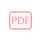
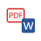
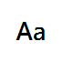

# rgPDF

[繁體中文](README.zh-TW.md) · English

The official application name is **rgPDF**; the command and Python package remain `rgpdf`.

rgPDF is a cross-platform desktop application for searching text-layer PDFs and Word documents with plain text or regular expressions. Matches appear as they are found and can be opened in an asynchronous page preview with precise, configurable highlighting.

## Features

- Search PDFs, Word documents (`.doc` and `.docx`), or both in a folder, optionally including subfolders.
- Plain-text and regular-expression modes with optional case sensitivity.
- Matches across lines and page boundaries, including line-end dehyphenation.
- Incremental per-match results without blocking the interface.
- Three coordinated views for files, matching passages, and PDF page preview.
- Per-character highlight geometry and configurable highlight colors.
- English and Traditional Chinese interfaces, plus system/light/dark themes.
- Persistent search and appearance preferences.

rgPDF searches existing PDF text layers. Word documents are converted to a cached PDF and then use the same search and preview pipeline. On Windows, Microsoft Word is tried first; LibreOffice is the cross-platform fallback. At least one of them must already be installed to search Word files. Cached conversions unused for 30 days are removed at startup; the cache is reduced by least-recent use when it exceeds 500 MB, and it can be cleared from the toolbar. rgPDF never runs document macros, does not perform OCR, and does not modify source files.

## Usage

The **Filename stem filter** below **Document folder** optionally limits which files are searched. Click the help icon immediately to the left of its input field to open syntax explanations and examples, just like Search pattern help. Leave it empty for no filter. It matches the entire filename without its last extension, ignoring case, and supports `*` (any string), `?` (one character), `[abc]`, `[0-9]`, and `[!abc]`. For example, `ch0*` includes `ch01.pdf` and `ch02.docx` but excludes `ch1.pdf` and `ch2.docx`; `ch01` matches that exact stem. The filter applies before PDF reading or Word conversion and works together with file-type and subfolder settings. It is saved between sessions and is independent of the text search’s regex and case settings.

Choose a folder with **Browse**, enter text or a regular expression, and click
**Search**. Select a file and matching passage to preview its page and highlight. Use the preview’s Previous page / Next page buttons to browse all document pages, including pages without a match. Select another passage in the match pane to jump to its matched page. **Fit page** scales the whole page to the preview’s width and height and adapts when the pane is resized; **Fit width** remains available for reading at a larger size.
The toolbar controls below are listed in their on-screen order. Hover over a
button to see its current setting; clicking a three-state button cycles modes.

| Toolbar icon | Control | Usage |
| --- | --- | --- |
|  | Include subfolders | Toggle recursive folder search. |
|    | File types | Cycle PDF → Word (DOC/DOCX) → both. Word requires Microsoft Word on Windows or LibreOffice. |
|  | Case sensitive | Toggle case-sensitive matching. |
|  | Regular expression | Toggle regex; use the help icon beside the search field for examples. |
|  | Highlight color | Choose a preset or custom color. |
|  | Clear Word cache | Confirm deletion of conversion PDFs; original Word files are preserved. Disabled during search. |
|    | Language | Cycle system → Traditional Chinese → English. |
|    | Color theme | Cycle system → light → dark. |
|  | About | View version, license, and source links. |

All action buttons use icons; hover to see their original labels in the selected language. Search, color, and preview controls:

| Icon | Tooltip / action |
| --- | --- |
|  | Browse… |
|  | Search |
|  | Cancel |
|  | Search pattern help |
|  | Custom color… |
|  | Previous page |
|  | Next page |
|  | Zoom out |
|  | Zoom in |
|  | Fit width |
|  | Fit page |

Search settings are saved between sessions. Conversion cache is cleaned at
startup: entries unused for 30 days expire, then the oldest entries are removed
if total size exceeds 500 MB. Use **Cancel** to stop a search.

## Install the latest release

### Windows standalone download

Download the versioned `rgpdf-*-windows-x86_64.exe` and its `.sha256` file
from the [latest GitHub Release](https://github.com/codemee/rgpdf/releases/latest).
The executable is currently unsigned, so Windows SmartScreen may show an
unknown-publisher warning. Verify that the SHA-256 value matches the published
file before choosing to run it.

No Python or uv installation is required for the standalone executable. PDF search has no additional requirement. Word search requires an existing Microsoft Word installation on Windows or an existing LibreOffice installation.

### macOS App (Apple Silicon)

Download the versioned `rgpdf-*-macos-arm64.dmg` and its `.sha256` file from
the [latest GitHub Release](https://github.com/codemee/rgpdf/releases/latest).
Verify the download first:

```shell
shasum -a 256 rgpdf-*-macos-arm64.dmg
```

After confirming that the output matches the `.sha256` file, open the DMG and
drag `rgpdf.app` to Applications. This build supports Apple Silicon (M-series)
Macs and does not require Python or uv.

The App is ad-hoc signed and not notarized by Apple. If macOS blocks its first
launch, Control-click `rgpdf` in Finder's Applications folder, choose Open,
then choose Open again in the confirmation dialog.

### Install with uv

Install [uv](https://docs.astral.sh/uv/), then install the latest release from PyPI:

```shell
uv tool install rgpdf
```

Run the application:

```shell
rgpdf
```

To update an existing installation:

```shell
uv tool upgrade rgpdf
```

Windows and macOS are supported; uv manages the required Python environment.

To install the latest source release directly from GitHub instead, use the moving `latest` tag:

```shell
uv tool install "git+https://github.com/codemee/rgpdf.git@latest"
```

## Development

```shell
git clone https://github.com/codemee/rgpdf.git
cd rgpdf
uv sync
uv run pytest
uv run rgpdf
```

Local development runs tests and the application with uv. Executable and App
artifacts are built remotely by GitHub Actions when a version tag is pushed;
do not build them locally. The release includes a Windows single executable,
a macOS Apple Silicon DMG, checksums, and corresponding source archives.

After toolbar artwork changes, regenerate the README images with
`uv run python scripts/generate_toolbar_icons.py`.

See [Technical details](docs/TECHNICAL.md) for architecture, matching semantics, concurrency, and release engineering. Version history is in the [changelog](CHANGELOG.md).

## Releases

Immutable releases use version tags such as `v0.0.3`. The movable `latest` Git tag always points to the newest published source release. PyPI provides the canonical packaged release.

Releases are automated with GitHub Actions. After making the versions in
`pyproject.toml` and `src/rgpdf/__init__.py` match, push the corresponding tag:

```shell
git tag v0.0.8
git push origin v0.0.8
```

The workflow tests and builds Windows x86_64 and macOS arm64 in parallel,
downloads and verifies the locked third-party corresponding sources, creates
one GitHub Release with checksums, then publishes to PyPI through Trusted
Publishing. A failed test, build, or source verification prevents publication.

## License

rgPDF is licensed under the [GNU Affero General Public License version 3](LICENSE).
You may use, study, modify, and redistribute it under the terms of that license.
Distributed binaries must be accompanied by the complete corresponding source
for the same version.

This application uses PyMuPDF/MuPDF under AGPLv3 and PySide6/Qt under LGPLv3.
See [third-party notices](THIRD-PARTY-NOTICES.md) and the
[release compliance checklist](docs/RELEASING.zh-TW.md).
